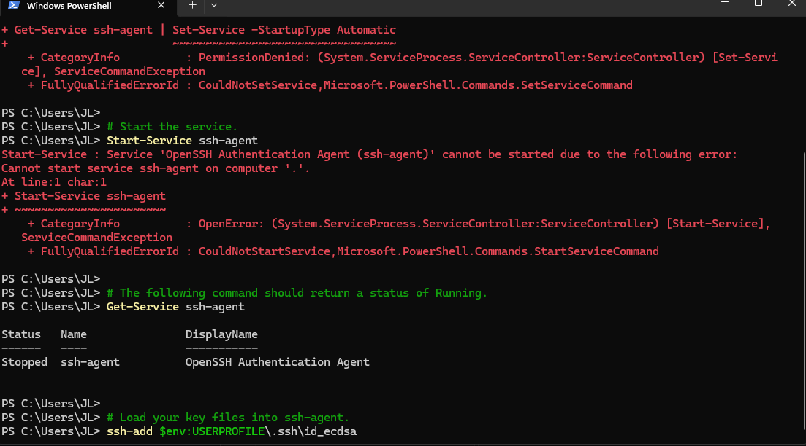
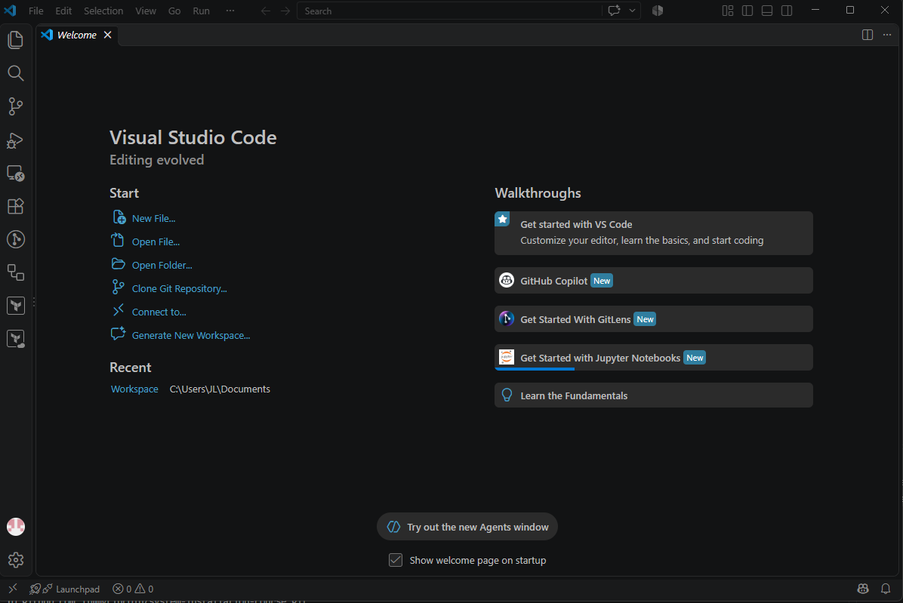
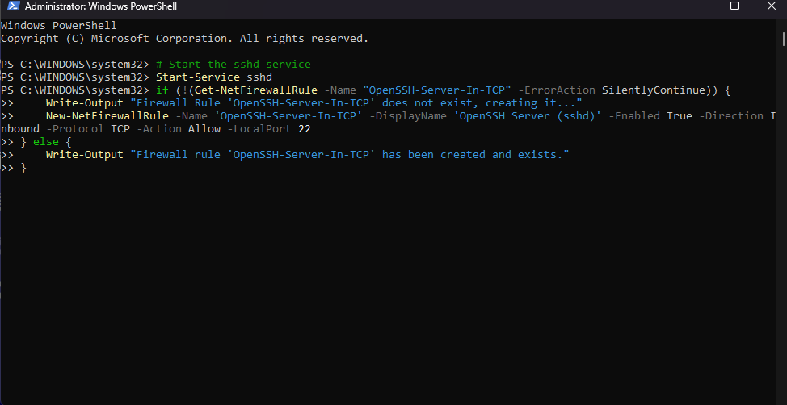
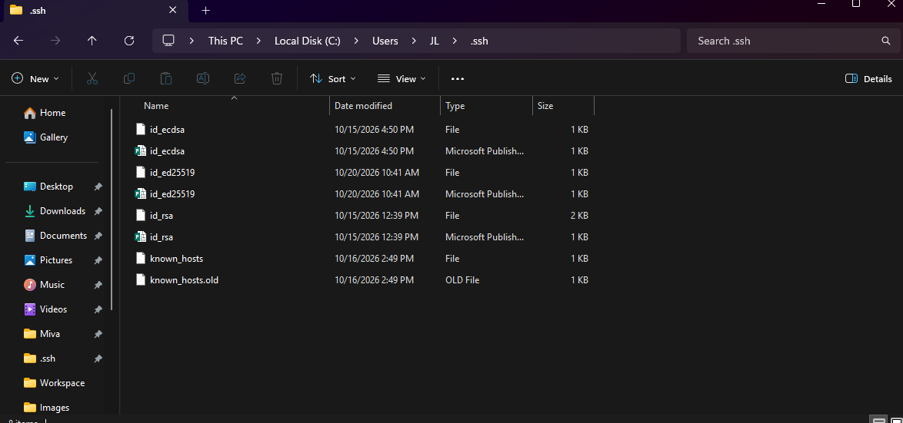
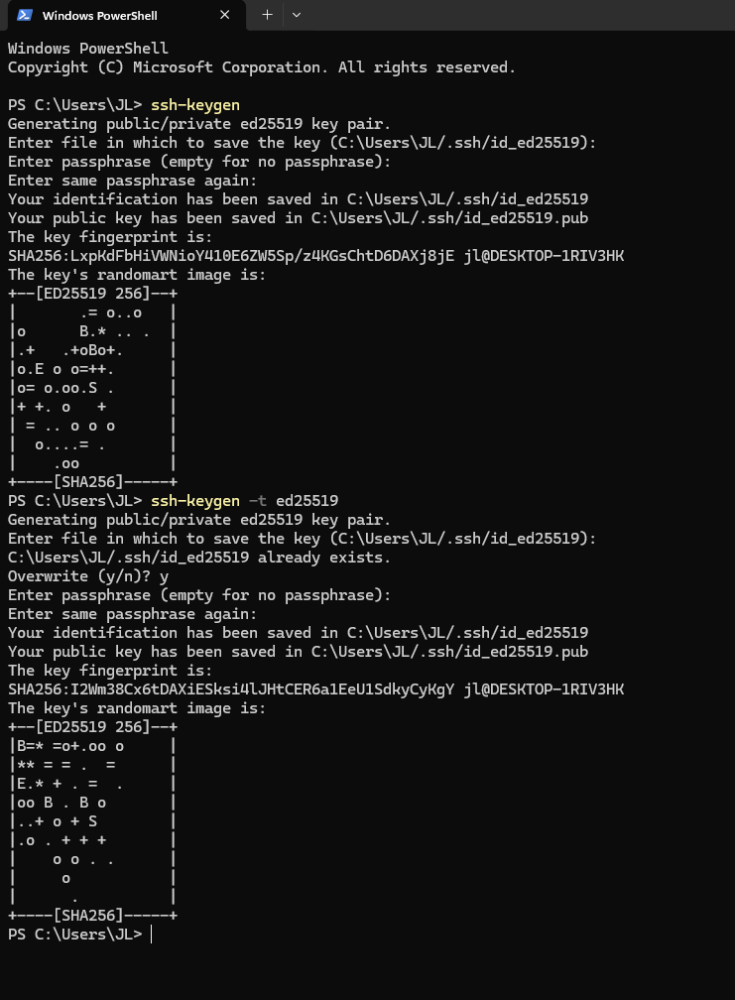
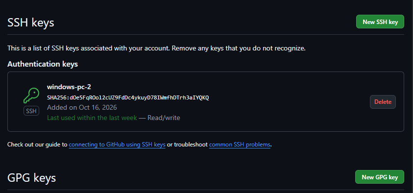
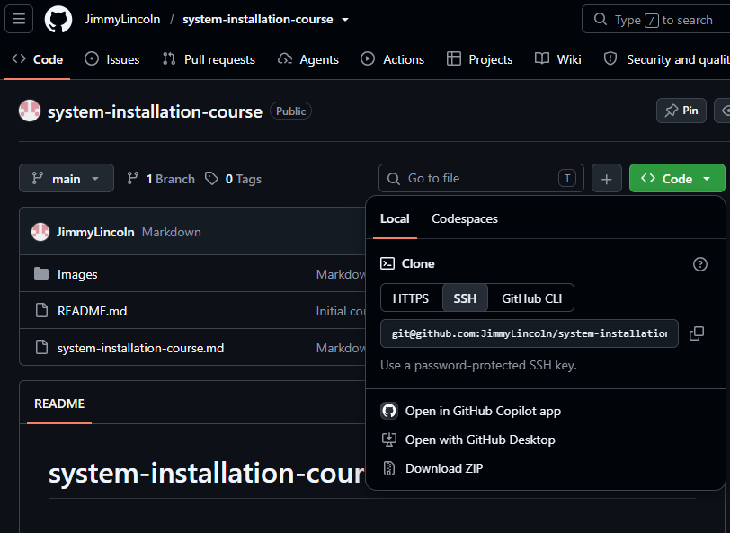

## This is a simple markdown document

## This is Bash Installation Image
***

### The Installation was seamless
***
## This is PowerShell Installation Image
***

### The Installation was seamless
***
## This is Visual Studio Installation Image

***
## The Installation was perfectly executed. i was able to install the *VS* seamlessly
***
## This is SSH Installation Image

***
## This is SSH Key Generated Image

***
## This is SSH Key Generating Process Image

***
## This is to add SSH Key to your repository Image

***
## This is GIT Clone Image

***

# At first i found it difficult adding image, but i later got it.